# Boxoffice, end to end

Everything about this project in one place: what it is, how every part works,
why each decision went the way it did, and what I would say if someone pushed
back on it.

Written to be read top to bottom once, then skimmed. The deep sections have
the code in them, because "I locked the rows" and being able to show the
`FOR UPDATE` are not the same answer.

- [1. The pitch](#1-the-pitch)
- [2. The one hard problem](#2-the-one-hard-problem)
- [3. Architecture](#3-architecture)
- [4. The data model](#4-the-data-model)
- [5. A booking, end to end](#5-a-booking-end-to-end)
- [6. Concurrency in detail](#6-concurrency-in-detail)
- [7. Money: payments, webhooks, idempotency](#7-money-payments-webhooks-idempotency)
- [8. Auth](#8-auth)
- [9. How it is proven](#9-how-it-is-proven)
- [10. The numbers](#10-the-numbers)
- [11. The mobile app](#11-the-mobile-app)
- [12. Deployment and operations](#12-deployment-and-operations)
- [13. Bugs I found, and how](#13-bugs-i-found-and-how)
- [14. Trade-offs and what I would do next](#14-trade-offs-and-what-i-would-do-next)
- [15. Questions I expect](#15-questions-i-expect)

---

## 1. The pitch

> Boxoffice is a movie ticketing platform for Indian multiplexes: an Expo
> React Native app, a Node/TypeScript API, Postgres and Redis. It is built
> around one claim that I can actually prove rather than assert, which is that
> it never oversells a seat. Ten load runs at up to five thousand concurrent
> users against a fixed three hundred seat house produced zero oversells, zero
> double charges, and zero invariant violations, and the verdict comes from a
> script that reads the database afterwards rather than from the load
> generator's own view of its requests.

Thirty seconds. If they want more, the next thing to say is _why_ that claim
is hard, which is section 2.

**Scale of the thing**

| Area              | Lines  | Files |
| ----------------- | ------ | ----- |
| `apps/api`        | 9,779  | 72    |
| `apps/mobile`     | 15,577 | 145   |
| `packages/shared` | 847    | 7     |
| `loadtest`        | 276    | 1     |

22 Prisma models, 40 API routes, 13 database invariants, 7 chaos scenarios,
190 API tests, 205 mobile tests.

---

## 2. The one hard problem

Selling a seat is not like selling a book. A book has stock; a seat is a
specific, named thing, and two people must never leave with the same one.
Everything interesting in the codebase comes from that.

The naive version is a race:

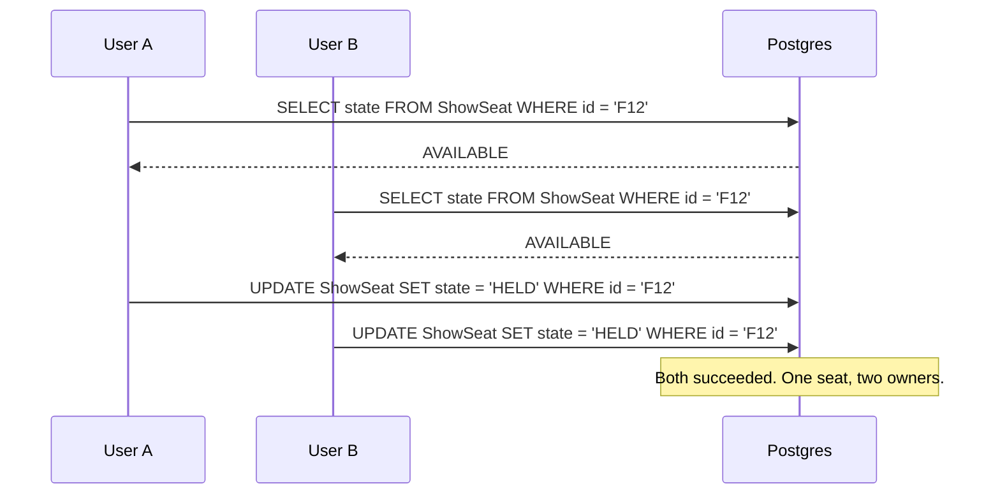

The window between the check and the write is where the bug lives. You can
make it smaller; you cannot make it zero by being careful.

**The fix is to make the check and the lock the same statement.**
`apps/api/src/modules/holds/holds.service.ts`:

```sql
SELECT ss.id, ss."priceMinor", s."rowLabel", s."number", s."tier"
FROM "ShowSeat" ss
JOIN "Seat" s ON s.id = ss."seatId"
WHERE ss."showtimeId" = $1
  AND ss.id = ANY($2::text[])
  AND (
    ss.state = 'AVAILABLE'
    OR (ss.state = 'HELD' AND ss."holdExpiresAt" <= now())
  )
ORDER BY ss.id
FOR UPDATE OF ss
```

Four things are load-bearing in that query, and an interviewer who knows what
they are looking at will ask about each:

**`FOR UPDATE`** takes a row lock as part of the read. A second transaction
asking for the same row blocks until the first commits or rolls back. There is
no window, because the check _is_ the lock.

**The row count is the test.** If I asked for three seats and got three rows
back, I hold all three. If I got two, someone else has one, and the whole
transaction rolls back rather than leaving a partial hold:

```ts
if (locked.length !== showSeatIds.length) {
  throw await describeConflict(tx, showtimeId, showSeatIds, locked);
}
```

All or nothing. A user who asked for three adjacent seats does not end up with
two and a gap.

**`OF ss`** restricts the lock to the inventory rows and excludes the joined
`Seat` catalogue. Without it, two people booking different showtimes in the
same auditorium would contend on the same physical seat records, which have
nothing to do with either booking.

**`ORDER BY ss.id`** makes every concurrent request take its locks in the same
order. Deadlocks come from A holding 1 and wanting 2 while B holds 2 and wants
1; a global order makes that impossible. The ones that still happen (Postgres
can deadlock on index pages) are caught by a retry wrapper, not by hoping.

### Hold expiry needs no background job

This is the part I am most pleased with, and it is the thing to volunteer when
someone asks "what happens if your cleanup job dies?"

The seat state is `HELD` with a `holdExpiresAt`. **Every read path treats a
lapsed `holdExpiresAt` as available** — that is the `OR (state = 'HELD' AND
holdExpiresAt <= now())` arm above, and the same rule appears in the seat map
query and the availability calculation. So a seat is free the instant its hold
runs out, whether or not any sweeper has run.

There _is_ a sweeper, but it is housekeeping: it tidies stale rows so the
tables read honestly, and it emits the realtime events that tell connected
clients a seat came back. If the sweeper never runs, the system still never
oversells. That distinction is why a missed tick is an inconvenience rather
than an incident, and `sweeper-disabled` is one of the seven chaos scenarios
precisely to prove it.

---

## 3. Architecture

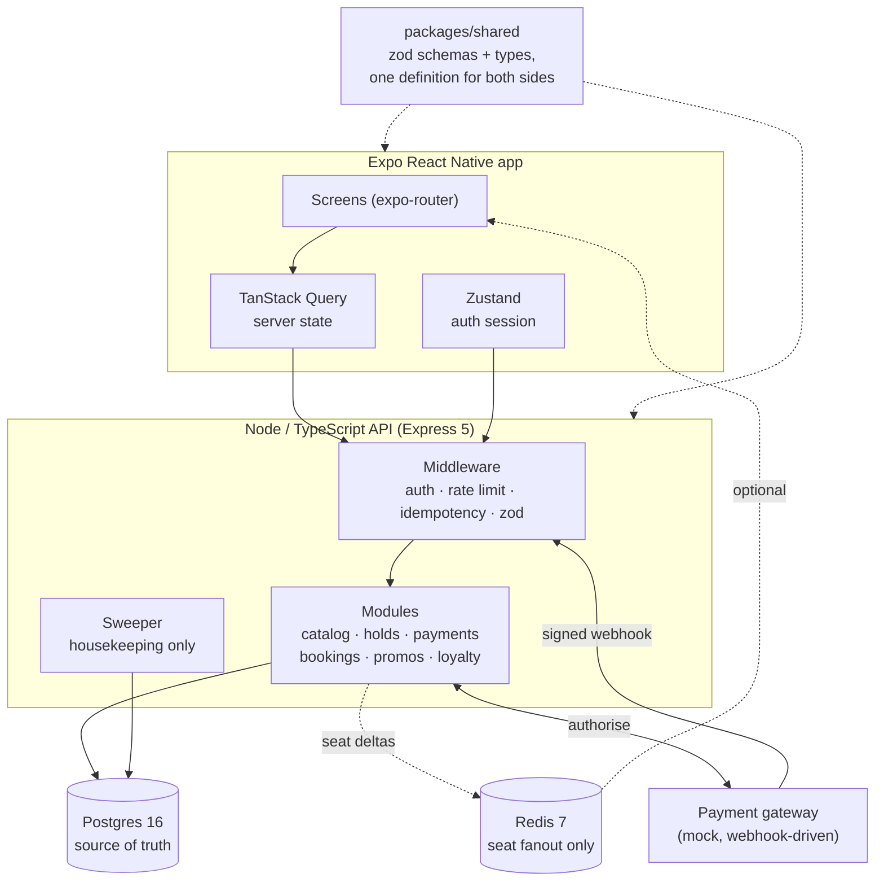

**Why a monorepo with a shared package.** The request and response shapes are
defined once as zod schemas in `packages/shared` and imported by both sides.
The API validates with them; the app infers its TypeScript types from the same
objects. A field renamed on the server is a compile error in the app, not a
runtime surprise. This is the single highest-leverage structural decision in
the project.

**Why Postgres and not something else.** The whole product is one transaction
with a row lock in it. That is exactly what a relational database with real
MVCC and `SELECT ... FOR UPDATE` is for. A document store would have made me
build the locking by hand.

**Why Redis is optional, and why that matters.** Redis carries one thing: the
realtime fanout of seat state changes, so a map someone is looking at updates
when a seat goes. It holds no state that anything is read back from. The
client connects lazily, every call site tolerates it being unreachable, and
the deployed production service runs with no Redis at all. Booking is
unaffected; seat changes arrive on the next refetch instead of being pushed.
If asked "what is your single point of failure", the honest answer is Postgres
and only Postgres.

**Why Express and not Nest/Fastify.** Nothing here needed a framework's
opinions. The interesting code is the SQL and the transaction boundaries, and
Express stays out of the way of both. I would pick Fastify if throughput were
the goal; it is not, latency under lock contention is.

---

## 4. The data model

22 models. These are the ones that matter.

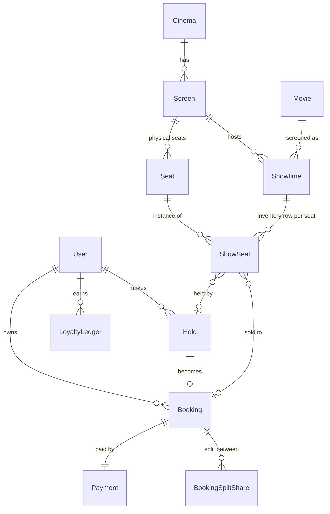

### The decision that makes the rest work: `ShowSeat`

A `Seat` is a physical chair in a `Screen` — row F, number 12, recliner tier.
It exists once and never changes.

A `ShowSeat` is **one row per seat per showtime**. If a 300-seat screen has
six screenings today, that is 1,800 inventory rows. The seed creates 252,720
of them.

That looks wasteful until you see what it buys: **the thing being locked is a
real row.** `SELECT ... FOR UPDATE` needs something to lock. If availability
were computed — "seats in the screen, minus seats in confirmed bookings" —
there would be no row to lock and I would be back to check-then-write with a
race in the middle. Materialising inventory is what turns the hard concurrency
problem into a row lock.

The state machine on that row:

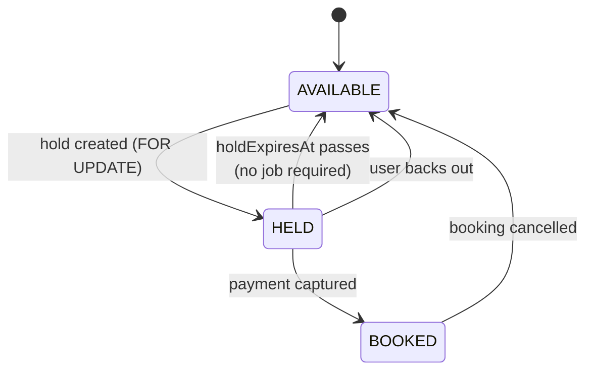

### Money is integers

Every amount is `*Minor` — paise, as an `Int`. There is no float anywhere near
a price. `BOOKING_FEE_MINOR` is `3000`, which is ₹30. Formatting to "₹630"
happens once, in a shared helper, at the edge.

If asked why: 0.1 + 0.2 is not 0.3 in binary floating point, and a ticketing
system that is off by a paise on a reconciliation report is a ticketing system
nobody trusts.

### Timestamps, and a bug this caused

Prisma maps `DateTime` to `timestamp without time zone`. That means the
connection's timezone decides what the values mean. A managed Postgres that
hands out a non-UTC connection silently shifts every `holdExpiresAt`, and the
symptom looks exactly like a locking bug: holds expiring early or late for no
reason.

`apps/api/src/lib/database-url.ts` pins it:

```ts
export function pinConnectionToUtc(url: string): string {
  if (/[?&]options=/i.test(url)) return url;
  return `${url}${url.includes('?') ? '&' : '?'}options=-c%20timezone%3DUTC`;
}
```

Applied to whatever URL the host hands over, in `env.ts` and in
`prisma.config.ts`. This is a good thing to bring up unprompted: it shows you
know where your ORM's abstraction is leaking.

---

## 5. A booking, end to end

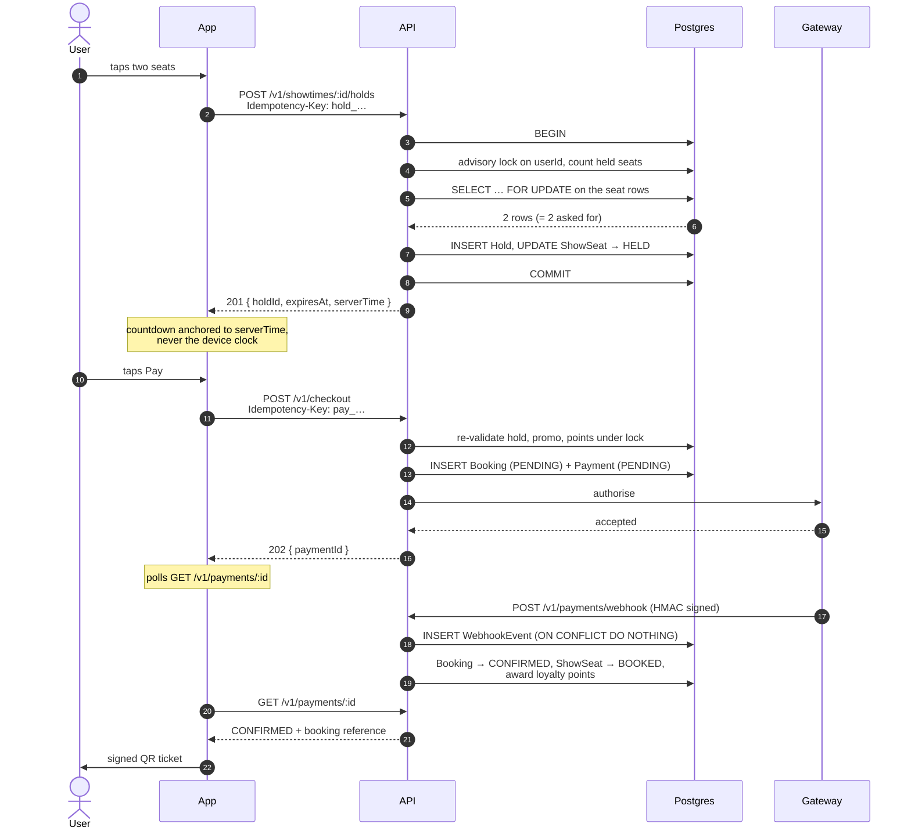

The three things worth narrating from that diagram:

**The hold is a real database state, not a UI nicety.** Most "your seats are
reserved" timers are a client-side countdown over inventory anyone can still
take. Here the seat row is genuinely `HELD` and a competing `FOR UPDATE` will
not return it.

**The countdown is anchored to server time.** The hold response carries both
`expiresAt` and `serverTime`. The client computes the remaining time from the
difference, not from its own clock. A phone whose time is wrong by two hours
still gets a five-minute hold.

**The payment confirms by webhook, not by the response to the checkout call.**
The checkout request returns 202 and a payment id; the booking becomes
`CONFIRMED` when the gateway's signed webhook arrives. This is how real
gateways work, and it forces the system to handle the genuinely hard cases:
the webhook arriving twice, arriving out of order, or never arriving at all.

---

## 6. Concurrency in detail

### Retry on serialisation failure

`withTxRetry` wraps the booking transaction. Postgres can still raise a
deadlock or serialisation failure despite the lock ordering — index-page level
conflicts do not respect my `ORDER BY`. Those are retried; anything else is
rethrown. A lock timeout is set per transaction so a pathological case fails
fast instead of occupying a connection.

### Idempotency

Every state-changing request carries an `Idempotency-Key` header. The record
is a row with a state:

- First request with a key: insert `IN_PROGRESS`, do the work, store the
  response, mark `COMPLETED`.
- Same key, same body, arriving again: replay the stored response. No second
  hold, no second charge.
- Same key, **different** body: `422 IDEMPOTENCY_KEY_REUSED`. This is a client
  bug and must not silently return someone else's result.
- Same key still `IN_PROGRESS`: `409 REQUEST_IN_PROGRESS`, retry shortly.

There is a subtlety worth knowing, because it is the kind of thing that gets
asked: the unique constraint is on the key alone, not on `(userId, key)`. So
two different users sending the same literal key string would collide. The
code checks the owner and refuses to hand user A the result of user B's
request. A test asserts exactly that.

**Where the key comes from matters too.** The app mints one key per _attempt
at the same seats_ and keeps it across failures, so a retry replays rather
than claiming a second hold — but mints a fresh one when the selection
changes, so choosing different seats is a different request. The fingerprint
is the sorted seat id list.

### The per-user hold cap

Added after an audit of this project found the gap. The per-request cap is ten
seats; the hold rate limit is thirty requests a minute. That is three hundred
seats a minute from one account, and a seeded auditorium is 150 to 400 seats.
One script could hold an entire screen and keep re-holding it as the holds
expired, and every real user would see SOLD OUT.

The fix is a cap on seats held concurrently _per account_, checked inside the
transaction under `pg_advisory_xact_lock(hashtext(userId))`:

```ts
await tx.$executeRaw`SELECT pg_advisory_xact_lock(hashtext(${userId}))`;
const held = await tx.hold.aggregate({
  where: { userId, status: 'ACTIVE', expiresAt: { gt: now } },
  _sum: { seatCount: true },
});
if ((held._sum.seatCount ?? 0) + showSeatIds.length > env.MAX_SEATS_HELD_PER_USER) {
  throw HttpError.tooManyHolds(env.MAX_SEATS_HELD_PER_USER);
}
```

Two details to be able to defend:

- **Why an advisory lock and not a row lock?** The quantity being checked is a
  _sum over many rows_, so there is no single row to `FOR UPDATE`. Without
  serialising per user, two concurrent requests would both read the old count
  and both pass. The lock is keyed on the user, so it never contends with a
  different account booking the same showtime. The same device is used for
  loyalty point redemption, for the same reason: a balance is a sum over a
  ledger.
- **Why `expiresAt > now` and not `status = 'ACTIVE'` alone?** Because expiry
  is logical everywhere else in this system too. A lapsed hold frees the
  budget immediately rather than waiting for the sweeper, exactly as it frees
  the seat.

And a cap per account is only worth anything if accounts are scarce, which is
why registration is rate limited separately — see section 8.

---

## 7. Money: payments, webhooks, idempotency

### Webhook authenticity

The signature is HMAC-SHA256 over the **raw request bytes**, not over
re-serialised JSON — `JSON.parse` then `JSON.stringify` does not round-trip
byte for byte, and key order or whitespace would break the signature. Express
is configured with a `verify` hook so the raw buffer survives body parsing.

Comparison is `timingSafeEqual` with a length check first. A missing header
and a wrong secret produce the same 400, with no hint which.

### Replay

```ts
INSERT INTO "WebhookEvent" (id, …) VALUES (…) ON CONFLICT DO NOTHING
```

Keyed on the gateway's own event id, and **not** a read-then-write — a check
followed by an insert is itself a race. `WebhookEvent` rows are never purged,
so the dedup window is permanent.

### Out of order

A capture can arrive before its authorisation. Payment statuses have a rank,
and a lower-ranked update never downgrades a higher-ranked one. `25/25
confirmed, 0 payments left below captured` is the chaos scenario that proves
it.

### Never arriving

`reconcilePendingPayments` runs in the sweeper and asks the gateway directly
about payments that have been pending too long. The `dropped-webhooks` chaos
scenario strands 20 payments with no callback at all and asserts all 20 are
confirmed by reconciliation.

### The honest hard case

A capture can land _after_ the hold has already expired and the seats have
gone back. There is no clever fix: the money moved and the seat is gone. The
code handles it explicitly rather than overselling — the booking does not get
confirmed, and the failure path reverses any loyalty points it had redeemed.
Being able to name this case, rather than pretending it cannot happen, is the
answer an interviewer is actually looking for.

---

## 8. Auth

Access token: 15 minutes, HS256. Refresh token: 30 days.

**Algorithm pinned.** `algorithms: ['HS256']` on both verifies, which closes
`alg: none` and HS/RS confusion.

**Separate secrets for access and refresh, plus a `type` claim.** Even if the
secrets were ever the same, an access token could not be presented as a
refresh token, because the claim schema requires the right literal.

**Refresh tokens are stored as SHA-256 hashes.** A database dump does not hand
over replayable sessions.

**Rotation with reuse detection.** Every refresh issues a new token and
revokes the old one. If a _revoked_ token is presented, that means someone
replayed a stolen one — and the response is to revoke the entire family, which
logs out the attacker and the real user, who then signs in again. This is the
part most implementations skip.

**Registration is rate limited separately from login**, and this is a subtler
decision than it looks. Login uses `skipSuccessfulRequests: true`, so only
failed guesses spend the budget and someone signing in all evening never runs
out. Registration must do the opposite: there, _success is the abuse_, because
every 201 is a fresh identity, and an unlimited supply of identities defeats
every per-account limit elsewhere — including the hold cap from section 6.
They need separate limiter instances, because `express-rate-limit` keys its
store per limiter and sharing one would make failed logins eat the signup
budget.

**What a request is counted against matters more than the number.** Everything
was originally keyed by IP address, which is wrong the moment several people
share a network — and this app's whole purpose is to be shown to a room. One
person doing one booking is about thirty requests over two or three minutes,
so at 120 a minute per address roughly the ninth person in the room started
being refused, having done nothing wrong. An authenticated request is now
counted against the **account**, which is both kinder and stricter: a
neighbour's browsing no longer spends your budget, and an attacker cannot
escape a per-account limit by changing address. A token that does not verify
falls back to the address deliberately — if nonsense could mint a bucket the
limiter would be decorative, and there is a test that sends three different
pieces of nonsense to prove it does not.

Sign-in cannot use that key, because the caller is not signed in yet, so it is
two limiters: tight per account, which is what stops somebody guessing one
person's password, and loose per address, which only bounds a spray across
many accounts. Keying it by address alone was wrong in both directions — ten
typos on a shared wifi locked everyone else out for a quarter of an hour,
while a patient attacker who changed address was never slowed at all.

And the liveness probe is exempt from all of it. It is a static object that
touches nothing, and it is what a phone polls every two seconds while a
sleeping free host wakes; a room cold-starting together would otherwise spend
the whole address budget on probes and then be refused the request they were
waiting to make.

---

## 9. How it is proven

Five layers, and the ordering is the point: each one catches what the one
above it cannot.

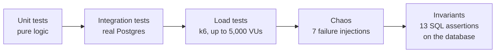

**Tests never run against a mocked database.** Every claim this project makes
is about behaviour under concurrent transactions, and a fake database cannot
exhibit that. The suite runs against a real Postgres in Docker, in CI too.

**The invariant script is the actual proof.** This is the thing to lead with
when someone asks how you know it works, because it is the part most projects
do not have. After any run — the test suite, a load test, a chaos scenario —
it reads the database and asserts thirteen properties in SQL:

| Invariant                 | What it rules out                                                   |
| ------------------------- | ------------------------------------------------------------------- |
| `no-oversell`             | Confirmed seats in a showtime exceeding capacity                    |
| `seat-single-booking`     | A confirmed seat with no booking, or pointing at an unconfirmed one |
| `booking-has-payment`     | A confirmed booking without exactly one captured payment            |
| `no-double-charge`        | More than one captured payment on a booking                         |
| `payment-has-booking`     | A captured payment with no confirmed booking                        |
| `confirmed-seat-count`    | A booking holding a different number of seats than its hold claimed |
| `booking-totals`          | Totals not equal to seats + fee + add-ons − discount                |
| `addon-total`             | Add-on total disagreeing with its priced lines                      |
| `promo-within-limits`     | A promo redeemed past its total or per-user limit                   |
| `held-seat-has-hold`      | A held seat with no hold, or the wrong expiry                       |
| `available-seat-is-clean` | An available seat still carrying a hold or booking                  |
| `no-orphaned-holds`       | A hold still ACTIVE well past its expiry                            |
| `no-stuck-payments`       | A payment pending for more than five minutes                        |

The distinction worth drawing out: **the load generator's opinion does not
count.** k6 can only tell you what responses it received. If the API returned
201 twice for the same seat, k6 would report two successes and a clean run.
Only reading the database afterwards catches it. That is why the verdict comes
from SQL.

**The seven chaos scenarios**, each stating its expectation before it runs:

| Scenario                       | What it proves                                                         |
| ------------------------------ | ---------------------------------------------------------------------- |
| `redis-restart`                | Booking is unaffected; Redis holds no seat state                       |
| `postgres-connections-dropped` | In-flight transactions roll back whole                                 |
| `slow-payment-gateway`         | Checkout returns fast against a 5s gateway; locks are not held waiting |
| `duplicate-webhooks`           | Every callback delivered twice, each payment captured once             |
| `out-of-order-webhooks`        | Capture before authorisation still confirms, no downgrade              |
| `dropped-webhooks`             | No callback ever arrives; reconciliation resolves it                   |
| `sweeper-disabled`             | Expired holds still read as available with no sweep                    |

Two of these found real bugs while being written. That is the honest and more
interesting thing to say about them.

---

## 10. The numbers

Ten runs, Postgres 16 and Redis 7 in Docker, API and k6 on the same laptop
(11 cores), 300 seats of inventory every time. Runs 1 to 7 are the debugging
history; 8 to 10 are current.

| #      | VUs       | Server             | Hold p99  | Unexpected responses | Confirmed | Oversells | Double charges |
| ------ | --------- | ------------------ | --------- | -------------------- | --------- | --------- | -------------- |
| 1      | 500       | 1 process, no gzip | 7,891 ms  | 1                    | 272       | 0         | 0              |
| 2      | 5,000     | 1 process, no gzip | 2,889 ms  | 12,985               | 269       | 0         | 0              |
| 3      | 5,000     | 8 workers, gzip    | 3,115 ms  | 14,683               | 269       | 0         | 0              |
| 4      | 500       | 8 workers, gzip    | 20 ms     | 0                    | 286       | 0         | 0              |
| 5      | 1,000     | 8 workers, gzip    | 85 ms     | 0                    | 275       | 0         | 0              |
| 6      | 2,000     | 8 workers, gzip    | 2,108 ms  | 231                  | 263       | 0         | 0              |
| 7      | 3,000     | 8 workers, gzip    | 10,473 ms | 1,694                | 281       | 0         | 0              |
| **8**  | **500**   | current            | **25 ms** | **0**                | 292       | **0**     | **0**          |
| **9**  | **1,000** | current            | **58 ms** | **0**                | 262       | **0**     | **0**          |
| **10** | **2,000** | current            | 6,367 ms  | **0**                | 279       | **0**     | **0**          |

**Confirmed plus still-held always came to exactly 300.** Every run. Including
the ones where the server was being crushed.

Things to say about this table rather than just quoting it:

- **The 200ms p99 target is met at 1,000 concurrent users (58ms), and missed
  at 2,000 (6.4s).** Saying so is better than hiding it. The bottleneck at
  2,000 is lock contention on a 300-seat inventory — by design, thousands of
  users are fighting over the same few hundred rows, which is the worst case a
  ticketing system can have and nothing like a normal day.
- **Correctness never degraded with load.** Runs 2 and 3 had ~13,000 unexpected
  responses from an overwhelmed server and still produced zero oversells. The
  system gets slower under pressure; it does not get wrong.
- **Runs 1 to 7 are kept on purpose.** The failed runs and what was wrong with
  them are in `docs/load-testing.md`. Deleting them would make the result look
  cleaner and mean less.

---

## 11. The mobile app

Expo SDK 57, React Native 0.86, React 19, expo-router. TanStack Query for
server state, Zustand for the auth session only.

**Why that split.** They are different problems. Server state is cached,
refetched, invalidated and can go stale — TanStack Query exists for exactly
that. The auth session is a small amount of genuinely client-owned state that
every request needs. Putting tokens in a query cache, or bookings in a Zustand
store, would be fighting the tool.

<p align="center">
  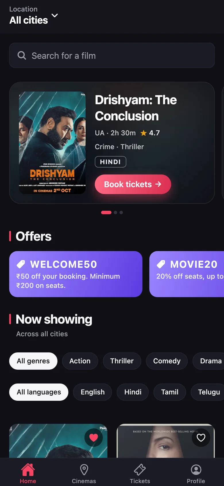
  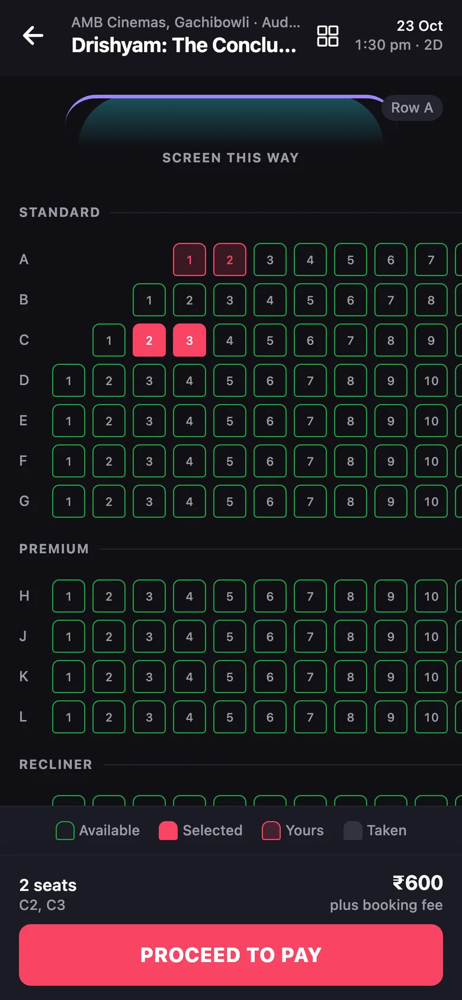
  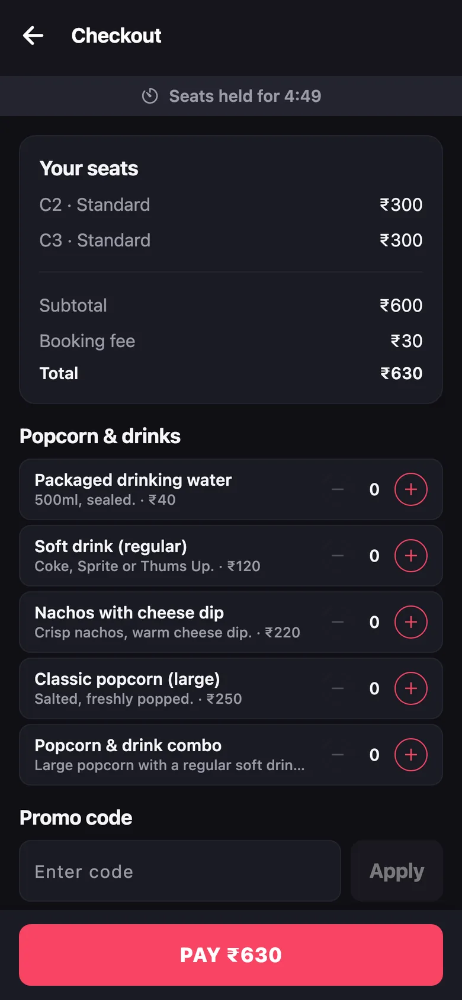
  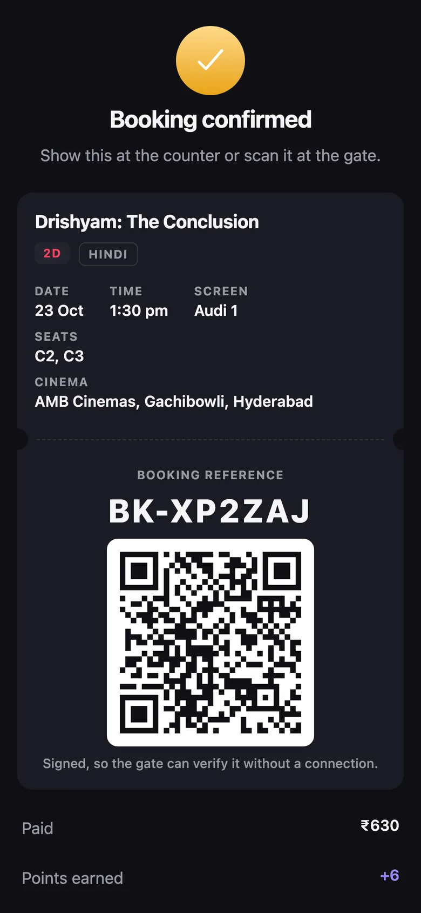
</p>

### The seat map, which is the hard screen

A 524-seat house, and the IMAX layout in the seed is 2,080 seats. Naively
mounting one component per seat does not survive contact with a mid-range
phone.

**Two axes of virtualisation.** Rows come from a `FlatList` with
`getItemLayout` supplied from precomputed offsets, so it never has to measure.
Columns are windowed by hand: a Reanimated shared value tracks horizontal
scroll on the UI thread, derives the first visible column, and `Row` renders
`null` for any seat outside the window plus a five-column buffer. Seat
geometry is fixed (`SEAT_SIZE` 28, `SEAT_GAP` 6, so a 34pt pitch), which is
what makes both offset tables computable rather than measured.

**Memoisation, and the bug that made it worthless.** `Seat` and `Row` are both
memoised, and `Row` has a hand-written comparator that compares a cheap
per-row `signature` string instead of a statuses array. All of it was defeated
by one line on the screen above it:

```tsx
// before
<SeatGrid onPressSeat={(seat) => { … }} />
```

A new function identity on every render. `Row`'s comparator ends with
`prev.onPressSeat === next.onPressSeat`, which could never be true, so one
tap re-rendered roughly 380 seats on the 524-seat house — and so did every row
boundary crossed while scrolling, which is precisely when frames are scarce.

`useCallback` alone does not fix it, because `selection.toggle` is itself a
new function after every tap. The fix is a ref-backed stable wrapper:

```tsx
const onPressRef = useRef<(seat: SeatMapSeat) => void>(() => {});
onPressRef.current = (seat) => {
  /* live body, never stale */
};
const onPressSeat = useCallback((seat: SeatMapSeat) => onPressRef.current(seat), []);
```

A tap now re-renders the one or two seats whose status actually changed.

This is a good story to tell in an interview because the lesson generalises:
**memoisation is only as good as the stability of every prop you pass**, and
one unstable callback silently turns a carefully optimised tree into an
unoptimised one with extra overhead.

### Honest data

A principle applied throughout, and worth stating as a principle:

- **Availability is a band, not a count.** Plenty, filling, almost full, sold
  out. Never "3 seats left", because that number was only true one request ago
  and showing it invites a user to act on something false.
- **Ratings are computed from real reviews.** One per person, editable, never
  stackable. An average with three reviews behind it says three.
- **Every countdown is anchored to server time.**

---

## 12. Deployment and operations

Live: API on Render, marketing site on GitHub Pages, APK on GitHub Releases.

`render.yaml` describes the service and its Postgres as a blueprint, so there
is no console form to fill in wrong. Four things in it exist because deploying
it the first time broke:

- **`npm ci --include=dev`.** `NODE_ENV=production` makes npm skip
  devDependencies, and prisma, tsup and tsx all live there. Without the flag
  the build dies on "tsup: not found".
- **Migrations run in the start command, not the build.** A build can run
  before the database is reachable. `migrate deploy` is idempotent, so running
  it on every boot is safe.
- **A guarded seed.** `prisma/seed.ts` is destructive — it clears bookings
  before rebuilding the catalogue. The start command runs on every deploy and
  every wake-from-idle, so it calls `db:seed:if-empty`, which only acts on a
  database with no films. A restart can never delete a ticket somebody booked.
- **`CORS_ORIGINS` must be set.** Zero parsed origins makes `cors()` reflect
  whatever `Origin` it is sent, which with credentials enabled would hand any
  website authenticated access. The env schema refuses to boot in production
  on an empty list.

**The free tier's one real catch.** The service sleeps after 15 minutes idle
and takes most of a minute to wake. The app handles it rather than showing an
error: it pings `/health/live` at launch so the server wakes while the intro
animation plays, and a `GET` that times out is retried once on a 50-second
budget. Mutations are never auto-retried — the user taps again, and the
idempotency key makes that safe.

---

## 13. Bugs I found, and how

This section is interview gold. "Tell me about a bug you found" is a standard
question and most answers are vague. These are specific, and each one has a
_method_ behind it.

**Loyalty points double-reversed.** A test expected a balance of 6 and got 12.
Cause: `confirmBooking`'s failure branch ran again after the sweeper had
already cancelled the booking, reversing the same redemption twice. My first
fix — bail out if the booking is no longer `PENDING` — broke a different
existing test that asserted FAILED takes precedence over CANCELLED. The right
fix was narrower: keep the original guards, and wrap only the
`reverseRedemption` call in an `alreadyCancelled` check. _Method: a test
caught it, and the second test stopped me from fixing it wrongly._

**Opening the app offline signed the user out permanently.** `restore()`
treated any failure of `me()` as a stale token and called `refreshSession()`,
whose catch cleared the keychain. A refresh is a POST, so the client never
retries it on a cold start — one dropped round trip destroyed the session. On
a free host that sleeps after fifteen minutes, this was the common path. Only
a 4xx counts as a rejection now. _Method: auditing what each catch block
actually catches, rather than what it was written to catch._

**`ErrorBoundary` rendered a blank screen.** Exported from a route file,
expo-router treats it as a _catch component_ and renders
`<ErrorBoundary error retry />` with no children — so returning
`this.props.children` returned `undefined`, which React renders as nothing.
Every crash it caught showed a blank screen and logged nothing. _Method: read
the library's source (`expo-router/build/views/Try.js`) instead of assuming
the contract._

**`npm test` exited 1 on a fully green suite.** 205 passing tests, exit code
1, intermittently. `expo-secure-store` has no headless implementation and its
call never settles under Jest, so every test rendering a provider leaked a
pending promise and the worker was force-exited. Mocking it in `jest.setup.js`
fixed the exit code _and_ took the suite from 35 seconds to 6. _Method:
noticing that a warning I had been ignoring was load-bearing._

**The released APK is signed with the public Android debug key.** `CN=Android
Debug` — the key that ships with every Android SDK on earth. Anyone could
build a malicious APK with the same package name, sign it with their own
debug key, and have Android accept it as a legitimate update. _Method: running
`apksigner verify --print-certs` on my own artefact instead of trusting that
"release build" meant "release signed"._

**A recording of the app made a claim that was not true.** While scripting a
walkthrough video, the promo-code step showed "fifty rupees off" over a total
that had not changed. The cause was in the recording harness, not the app:
matching a control by `innerText` also matches the row containing it, because
an input's value is not part of `innerText` — so the tap was landing on the
text field. _Method: I had made the script read the Pay button before and
after and refuse to narrate a discount it could not verify, which is the only
reason it got caught._

---

## 14. Trade-offs and what I would do next

Being able to criticise your own project is the difference between a good
answer and a great one.

**What I would defend**

- Materialised `ShowSeat` inventory. It is more rows, and it is what makes the
  correctness property provable rather than hoped for.
- Logical hold expiry. The system is correct with the cleanup job switched
  off, and a chaos scenario proves it.
- The invariant script. Without it, "never oversells" is a claim; with it, it
  is a check that runs.
- Redis being strictly optional.
- **The offline ticket, and how narrow it is.** The architecture used to
  contradict itself: the QR is signed precisely so a gate scanner can verify
  it with no network, but the app kept its cache in memory, so a user could
  not open their own ticket without one — and a cinema basement is exactly
  where that fails. The obvious fix was to persist the whole query cache. I
  did not, because a seat map that is stale on disk is actively harmful in a
  way a ticket is not. What is stored is one confirmed booking, trimmed to
  what a stub prints, written on confirmation and deleted the moment it stops
  being confirmed. One key per ticket, because `expo-secure-store` documents a
  2 KB ceiling per value on Android and a real ten-seat booking is already
  over it — a list would have failed silently, and first for the people with
  the most seats. The offline screen says when the copy was taken rather than
  claiming to be current, because a booking cancelled on another device would
  still be sitting there saying confirmed.

**What I would change**

- **The 2,000-VU latency.** 6.4 seconds p99 is honest but not good. The next
  thing to try is reducing the lock hold time inside the transaction, and
  sharding the advisory locks.
- **The seat map should be Skia.** Even with the memoisation fixed, 2,080
  seats as React components is the wrong shape. One canvas with hit-testing
  would be both faster and simpler.
- **No OTA updates.** Every JS fix currently needs a full APK redistribution.
  EAS Update would fix that.

**What I would build next**

Real seat-level realtime (the Redis fanout exists but the client only refetches),
a proper admin surface for cinema operators, and multi-currency — currently
the integer-paise assumption is baked in deeper than it should be.

---

## 15. Questions I expect

**"Why not just use a transaction with SERIALIZABLE isolation?"**
It would work, and it trades a predictable block for an unpredictable
rollback: under contention, SERIALIZABLE aborts transactions that `FOR UPDATE`
would merely have queued, and every abort becomes a retry. For a workload
where thousands of users target the same few hundred rows, I would rather
queue than thrash. I also only need to serialise access to specific known
rows, which is exactly what row locks are for.

**"What happens if the API crashes between the hold and the payment?"**
Nothing is lost and nothing is oversold. The hold is a committed database
state with an expiry; when it lapses, every read path treats the seats as
available again. The user comes back to a checkout screen that tells them the
hold expired and offers to choose seats again.

**"How do you know the load test isn't lying to you?"**
Because the verdict does not come from the load test. k6 only knows what
responses it received; if the API had returned 201 twice for one seat, k6
would report a clean run. The invariant script reads the database afterwards
and asserts in SQL that confirmed seats never exceed capacity. That is a
different source of truth.

**"Why is there a sweeper at all if expiry is logical?"**
Housekeeping and visibility, not correctness. It tidies stale rows so the
tables read honestly, reconciles payments whose webhook never arrived, and
emits the realtime events that tell connected clients a seat came back. The
`sweeper-disabled` chaos scenario exists to prove the system is still correct
without it.

**"What is the weakest part of this?"**
The mobile app had the thinnest failure handling, and auditing it found
several real dead ends — a shared ticket link that 404s used to leave a
full-screen error with no back button and nothing behind it in the stack, and
a ticket that could not be opened without a network even though its QR was
signed specifically so it would not need one. Those are fixed. What is left is
that the APK is signed with Android's public debug key, so its signature
proves nothing about who built it, and that there are no OTA updates, so every
JS fix needs a full redistribution.

**"Three hundred seats is small. Does this scale?"**
Three hundred is the _hard_ case, not the easy one: it concentrates every
request onto a few hundred rows. Scaling the catalogue is trivial because
reads are independent. Scaling contention within one showtime is the real
limit, and the honest answer is that the current design queues on row locks
and degrades in latency, not correctness — which the 2,000-VU run shows.

**"Why did you build the marketing site and the video?"**
Because an APK on its own does not tell anyone whether the thing works. The
walkthrough is a single unedited take of the real app against a running
server, and the recorder refuses to narrate anything it cannot verify — the
promo-code chapter reads the Pay button before and after applying the code and
only claims a discount once the total has actually moved.

<p align="center">
  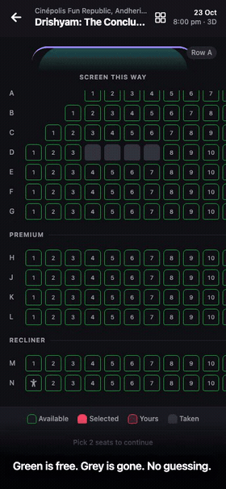
</p>

---

## Appendix: the map of the repo

```
apps/
  api/                 Express 5 + Prisma 7
    prisma/            schema, migrations, seed, guarded seed
    src/
      modules/         catalog, holds, payments, bookings, promos,
                       loyalty, concessions, reviews, auth, realtime
      middleware/      auth, rate limiting, idempotency, zod validation
      lib/             tokens, crypto, tx retry, idempotency, database-url
      jobs/sweeper.ts  housekeeping, reconciliation, realtime events
      scripts/         verify-invariants, chaos, load-test tooling
  mobile/              Expo SDK 57, expo-router
    src/
      app/             file-based routes
      features/        seatmap, checkout, auth, catalog, cinemas,
                       bookings, promos, reviews, watchlist, notifications
      components/ui/   the design system
      api/             typed client, one module per API area
packages/
  shared/              zod schemas and types used by both sides
loadtest/              k6 scenario
site/                  the marketing site, the canvas film, the walkthrough
docs/                  architecture, load-testing, seatmap-performance,
                       shipping-the-app, and this file
scripts/               record-walkthrough.mjs, local-infra.sh
render.yaml            the deployment blueprint
```

**Commands worth knowing by heart**

```bash
npm run dev                                   # API + app
npm run test                                  # every workspace
npm run verify:invariants --workspace @app/api
npm run loadtest                              # k6, then the invariant script
npm run chaos                                 # seven failure injections
```
